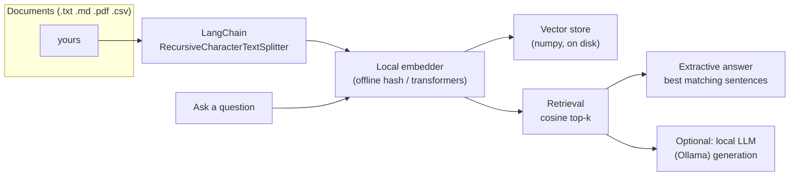

# rag-doc-qa

[](https://www.python.org/)
[](https://fastapi.tiangolo.com/)
[](https://www.langchain.com/)
[](LICENSE)

**Key-free RAG (Retrieval-Augmented Generation) question answering over your
own documents** — a FastAPI service + CLI that runs entirely locally, **no API
key required**.



## Why this project

2026 AI hiring focuses on engineers who can ship **LLM application plumbing**:
chunking, embeddings, retrieval, context assembly — not just prompt writing.
This repo demonstrates that loop end-to-end with a deliberately **honest,
key-free design**: the default embedder is a deterministic hashing embedder and
the vector store is numpy, so the entire project runs on a laptop with
`pip install -r requirements.txt`. No OpenAI key, no model downloads, no
account signup — the README and code say exactly that.

For better quality you can opt into a local transformer embedder
(`requirements-embeddings.txt`) and optional local LLM generation (Ollama) —
still no API key.

## Quick start

```bash
python -m venv .venv && source .venv/bin/activate   # Windows: .venv\Scripts\activate
pip install -r requirements.txt

# CLI
ragdoc ingest ./docs                 # index documents
ragdoc ask "How long is parental leave?"
ragdoc ask "How many remote days per week?" --json

# API
uvicorn app.main:app --reload --port 8000
#   docs at http://localhost:8000/docs
```

### Using the API

```bash
# 1. Ingest documents (text payload)
curl -X POST localhost:8000/ingest \
  -H "Content-Type: application/json" \
  -d '{"documents":[{"filename":"handbook.md","text":"Salaries are paid on the 5th business day. Employees get 30 vacation days."}]}'

# 2. Ask
curl -X POST localhost:8000/ask \
  -H "Content-Type: application/json" \
  -d '{"question":"When are salaries paid?","k":3}'

# 3. (Optional) local LLM generation via Ollama — still no API key
curl -X POST localhost:8000/ask \
  -H "Content-Type: application/json" \
  -d '{"question":"When are salaries paid?","use_llm":true}'
```

## Embedders

| Embedder | Works out of the box | Quality | Notes |
|---|---|---|---|
| `offline` (default) | ✅ no deps, no downloads | basic | deterministic hashing n-gram vectors (384 dims) |
| `transformers` | needs `pip install -r requirements-embeddings.txt` | good | `sentence-transformers` model runs locally, no key |

Switch with `RAG_EMBEDDER=transformers` (API) or `--embedder transformers` (CLI).

## Optional local LLM generation (Ollama)

The `use_llm: true` mode sends the retrieved context to a **local Ollama**
server (default `http://localhost:11434`, model `llama3.2`). If Ollama is not
running, the API falls back to the extractive answer and says so — the service
never depends on a hosted provider.

```bash
ollama pull llama3.2        # once
ollama serve                # keep it running
RAG_OLLAMA_MODEL=llama3.2 uvicorn app.main:app
```

## Docker

```bash
docker compose up --build --profile llm
# API  → http://localhost:8000
```

## Tests

```bash
pip install -r requirements.txt pytest
pytest                      # 8 tests — no network, no API keys, no model downloads
```

Tests cover the pipeline (chunking → indexing → retrieval → extractive answer)
and the HTTP API (health, ingest/ask flow, 409 on missing index, validation).

## Project structure

```
├── app/
│   ├── main.py          # FastAPI service (/health, /ingest, /ask)
│   ├── pipeline.py      # RAG orchestration (LangChain splitter + retrieval)
│   ├── embedders.py     # offline hash + optional transformer embedders
│   ├── store.py         # numpy cosine vector store with persistence
│   ├── loaders.py       # txt/md/csv/pdf loaders
│   └── schemas.py       # Pydantic request/response models
├── cli.py               # Typer CLI: ingest / ask / serve
├── docs/                # sample documents to ingest
└── tests/               # pytest suite (offline, key-free)
```

## Production notes (honest)

- The numpy store is a local demo store. For corpora beyond ~100k chunks, plug
  in a real vector database or FAISS behind the same `VectorStore` interface.
- The offline hash embedder is a toy compared to dense transformers — fine to
  prove the pipeline, not for semantic-heavy domains. Ship the transformer
  embedder for real use.
- Index persistence is plain files (`vectors.npz` + `meta.json`) — treat them
  like any data artifact (backup, object storage).

---

Built by **Sérgio Bernardelli Netto** · [Portfolio](https://sbnetto01.github.io/Portfolio-SBN/) · [LinkedIn](https://www.linkedin.com/in/sergio-b-netto/)